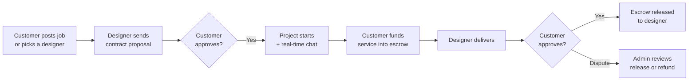
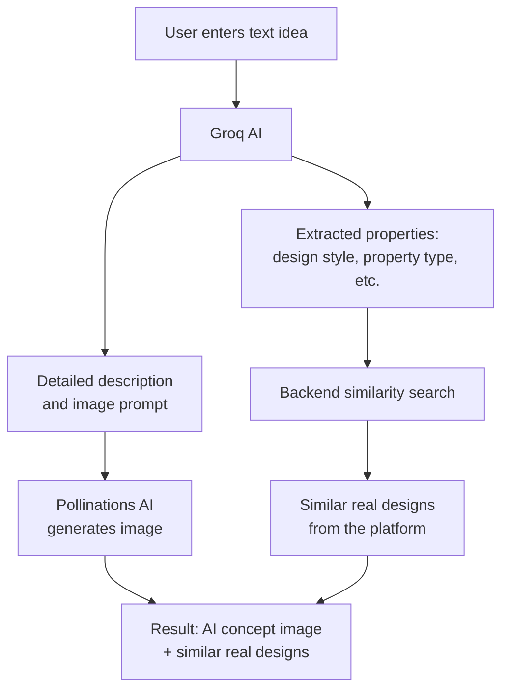

# 🎨 Designo

**An AI-powered, two-way interior design marketplace** that connects customers with designers, protects payments with escrow, and uses vector-based recommendations to match people with the right designs and jobs.

Built with the **MERN stack and TypeScript**, structured around a **repository architecture pattern**.

🔗 **Live demo:** https://www.designo.space/

📘 **API docs:** [Postman](https://documenter.getpostman.com/view/58996015/2sBYHSwfPX) · 🗄️ **DB design:** [Eraser](https://app.eraser.io/workspace/6YcrQTvL6StgVV1iHVeK)

---

## 📸 Screenshots

### Home Page


### Design Detail


### Contract


### Designer Dashboard


### Customer Dashboard


### Admin Dashboard


---

## 📑 Table of Contents

- [Overview](#-overview)
- [Key Features](#-key-features)
- [AI Features](#-ai-features)
- [Tech Stack](#-tech-stack)
- [Documentation](#-documentation)
- [Architecture](#-architecture)
- [Project Structure](#-project-structure)
- [Getting Started](#-getting-started)
- [Environment Variables](#-environment-variables)
- [Third-Party Service Setup](#-third-party-service-setup)
- [Admin Access](#-admin-access)
- [Testing Payments](#-testing-payments)
- [Deployment](#-deployment)
- [Future Improvements](#-future-improvements)
- [Author](#-author)
- [License](#-license)

---

## 🌟 Overview

Designo supports two ways of finding work:

1. **Public job requests:** a customer posts a job and designers apply.
2. **Direct hiring:** a customer browses designer portfolios and reviews, then approaches a designer directly.

Once matched, the designer submits a **contract proposal** with timelines, site visit schedules, and a service-based cost breakdown. When the customer approves it, the project begins, with a built-in real-time chat for communication.

Payments run through an **escrow-based milestone system**. Customers fund specific services up front, and the money is released to the designer only after the agreed result is delivered and approved. If something goes wrong (endless revision requests, missed delivery), a **dispute system** lets admins step in, review the case, and either release funds or issue a refund.



---

## ✨ Key Features

### 👤 Customer
- Sign up and log in with email or Google
- Post public job requests or approach designers directly
- Browse designs, designer portfolios, and reviews
- Review and approve contract proposals
- Fund services into escrow and release payments on approval
- Real-time chat with designers
- Save designs and get personalized design recommendations
- Generate conceptual designs with AI
- Raise disputes when needed

### 🎨 Designer
- Apply for designer verification and manage a portfolio
- Upload and manage designs
- Browse and apply to job requests, with AI-matched job recommendations
- Submit detailed contract proposals (timeline, site visits, service-based cost)
- Deliver work, handle revisions, and receive escrow payments
- Real-time chat and notifications

### 🛡️ Admin
- Dashboard with platform and transaction overview
- User management
- Designer application verification
- Dispute management (evaluate, release funds, or refund)
- Transaction monitoring

---

## 🤖 AI Features

### 1. Dual recommendation engine
Every design and job request gets a **vector embedding** at creation time, built from its style, description, and other attributes.

- **For customers:** designs are recommended based on their interactions.
- **For designers:** relevant job postings are matched to them.

When the recommendation endpoint is called, the backend computes **cosine similarity** between vectors, applies interaction-based weights, and returns the best matches.

### 2. AI design generator
A two-step flow that runs from the frontend:



1. The user's text goes to **Groq**, which turns it into a polished image prompt and extracts structured properties (design style, property type, etc.).
2. The prompt goes to **Pollinations AI** to generate the concept image.
3. The extracted properties go to the backend, which returns **similar real designs** from the database.

### 3. Real-time chat
Customers and designers communicate through **Socket.IO** with authenticated socket connections.

---

## 🧰 Tech Stack

| Layer | Technology |
|---|---|
| Frontend | React, TypeScript, Vite |
| Backend | Node.js, Express.js, TypeScript |
| Database | MongoDB (Mongoose), run as a replica set for transactions |
| Cache / Store | Redis (local, Upstash in production) |
| Real-time | Socket.IO |
| Authentication | JWT (access + refresh tokens), Google OAuth |
| Payments | Stripe (with webhooks) |
| AI | Groq, Gemini, Pollinations AI |
| Geocoding | OpenCage |
| Media Storage | Cloudinary |
| Email | Nodemailer |
| Logging | File-based error logs |
| Deployment | AWS (backend), Vercel (frontend) |

---

## 📚 Documentation

| Resource | Link |
|---|---|
| 🌐 Live application | [designo.space](https://www.designo.space/) |
| 📘 API documentation | [Postman docs](https://documenter.getpostman.com/view/58996015/2sBYHSwfPX) |
| 🗄️ Database design | [Eraser workspace](https://app.eraser.io/workspace/6YcrQTvL6StgVV1iHVeK) |
| 🎨 UI/UX design | _Add Figma link here_ |
| 💻 Source code | [GitHub](https://github.com/suhailts133/designo) |

---

## 🏗️ Architecture

The backend follows a **layered repository architecture**:

```
Routes → Controllers → Services → Repositories → Models (MongoDB)
```

| Layer | Responsibility |
|---|---|
| **Routes** | Define endpoints and attach middleware |
| **Controllers** | Handle HTTP requests and responses |
| **Services** | Business logic (escrow, proposals, recommendations) |
| **Repositories** | All database access, built on a shared `baseRepository` |
| **Models** | Mongoose schemas |
| **DTOs and mappers** | Shape data going in and out of the API |
| **Interfaces** | Contracts for services and repositories (loose coupling, easy testing) |
| **Validators** | Request validation |
| **Middlewares** | Auth, admin guard, socket authentication |

---

## 📁 Project Structure

```
designo/
├── frontend/                  # React + Vite client
└── backend/
    ├── logs/                  # Daily error logs
    └── src/
        ├── config/            # cloudinary, cors, logger, mongodb, oAuth, redis
        ├── controllers/       # admin, benchmark, common, designer, proposal, user
        ├── DTO/               # Request/response data shapes
        ├── dtoMappers/        # Entity → DTO mappers
        ├── interfaces/        # Service and repository contracts
        ├── middlewares/       # adminAuth, socketAuthentication, ...
        ├── models/            # Mongoose schemas (auth, designer, proposal, user, ...)
        ├── repositories/      # Data access layer (extends baseRepository)
        ├── routes/            # Route definitions by role
        ├── services/          # Business logic (auth, stripe, proposal, ...)
        ├── shared/            # emails, enums, errors, helpers, jwt, messages
        ├── socket/            # Socket.IO controllers
        ├── types/             # Type augmentations (e.g. express.d.ts)
        ├── validators/        # Request validators
        └── server.ts          # Entry point
```

---

## 🚀 Getting Started

### Prerequisites

- [Node.js](https://nodejs.org/) v20 or later, and npm
- [MongoDB](https://www.mongodb.com/try/download/community) running as a **replica set** (required for transactions)
- [Redis](https://redis.io/) running locally, or an Upstash Redis URL
- [Stripe CLI](https://stripe.com/docs/stripe-cli) (for testing webhooks locally)
- Accounts for: Google Cloud, Stripe (test mode), Cloudinary, Groq, Gemini, OpenCage

### Installation

```bash
# 1. Clone the repository
git clone https://github.com/suhailts133/designo.git
cd designo

# 2. Backend
cd backend
npm install
cp .env.example .env   # then fill in your values
npm run dev

# 3. Frontend (in a new terminal)
cd frontend
npm install
cp .env.example .env   # then fill in your values
npm run dev
```

- Backend runs at **http://localhost:3000**
- Frontend runs at **http://localhost:5173**

### MongoDB replica set (local)

Designo uses database transactions, which MongoDB only supports on a replica set:

```bash
# Start MongoDB with a replica set name
mongod --replSet rs0 --dbpath <path-to-your-data-folder>

# In another terminal, initialize it (first time only)
mongosh --eval "rs.initiate()"
```

Or use a free [MongoDB Atlas](https://www.mongodb.com/atlas) cluster (replica set by default) via `MONGODB_ATLAS_URI`.

---

## 🔐 Environment Variables

### Backend: `backend/.env`

```env
NODE_ENV=development
PORT=3000
CLIENT_URL=http://localhost:5173

# Email (Nodemailer)
NODEMAILER_EMAIL=your_email@example.com
NODEMAILER_PASSWORD=your_email_app_password

# Databases
MONGODB_URI=mongodb://127.0.0.1:27017/designo?replicaSet=rs0
MONGODB_ATLAS_URI=your_mongodb_atlas_uri
REDIS_UPSTASH_URI=your_upstash_redis_uri
REDIS__URI=redis://localhost:6379

# JWT
ACCESS_TOKEN_SECRET_KEY=your_access_token_secret
REFRESH_TOKEN_SECRET_KEY=your_refresh_token_secret
ACCESS_TOKEN_EXP_IN=15m
REFRESH_TOKEN_EXP_IN=7d

# Cloudinary
CLOUDINARY_CLOUD_NAME=your_cloud_name
CLOUDINARY_API_KEY=your_api_key
CLOUDINARY_API_SECRET=your_api_secret

# Google OAuth
GOOGLE_CLIENT_ID=your_google_client_id
GOOGLE_CLIENT_SECRET=your_google_client_secret
GOOGLE_API_URI=https://www.googleapis.com/oauth2/v3/userinfo

# AI
GEMINI_API_KEY=your_gemini_api_key

# Stripe
STRIPE_PUBLISHABLE_KEY=pk_test_xxx
STRIPE_SECRET_KEY=sk_test_xxx
STRIPE_WEBHOOK_SECRET_DEV=whsec_xxx
STRIPE_WEBHOOK_SECRET_PROD=whsec_xxx
```

### Frontend: `frontend/.env`

```env
VITE_BASE_URL=http://localhost:3000
VITE_API_URL=http://localhost:3000/api
VITE_CLIENT_ID=your_google_client_id
VITE_STRIPE_PUBLISHABLE_KEY=pk_test_xxx
VITE_GROQ_API_KEY=your_groq_api_key
VITE_GEMINI_API_KEY=your_gemini_api_key
VITE_OPENCAGE_API_KEY=your_opencage_api_key
```

> ⚠️ Never commit `.env` files. Make sure both are listed in `.gitignore`.
> Variables starting with `VITE_` are bundled into the frontend and visible to anyone using the app. Use restricted or low-risk keys for them.

---

## 🔌 Third-Party Service Setup

**Google OAuth**
1. Open [Google Cloud Console](https://console.cloud.google.com/) → APIs & Services → Credentials.
2. Create an **OAuth 2.0 Client ID** (Web application).
3. Add `http://localhost:5173` as an authorized JavaScript origin.
4. Use the Client ID in both `.env` files and the Secret in the backend `.env`.

**Stripe**
1. Create an account and stay in **Test Mode**.
2. Copy the publishable and secret keys into the `.env` files.
3. Forward webhooks to your local server and copy the signing secret into `STRIPE_WEBHOOK_SECRET_DEV`:
   ```bash
   stripe listen --forward-to localhost:3000/api/<your-webhook-route>
   ```

**Cloudinary:** create a free account and copy the cloud name, API key, and secret.

**Groq / Gemini / OpenCage:** create API keys from each provider's dashboard.

**Nodemailer (Gmail):** enable 2-step verification and generate an **App Password** to use as `NODEMAILER_PASSWORD`.

---

## 👑 Admin Access

Register a normal account first, then promote it to admin in MongoDB (using `mongosh` or MongoDB Compass):

```js
db.users.updateOne({ email: "admin@email.com" }, { $set: { role: "Admin" } });
```

Log in with that account to access the admin dashboard.

---

## 💳 Testing Payments

Use Stripe **test mode** only. Do not use real cards.

| Field | Value |
|---|---|
| Card number | `4242 4242 4242 4242` (Visa) |
| Expiry | Any future date (e.g. `12/30`) |
| CVC | Any 3 digits (e.g. `123`) |
| ZIP / Postal code | Any (e.g. `12345`) |

More test cards: [Stripe testing docs](https://docs.stripe.com/testing)

---

## ☁️ Deployment

| Part | Platform |
|---|---|
| Frontend (React + Vite) | [Vercel](https://vercel.com/) |
| Backend (Node + Express) | [AWS](https://aws.amazon.com/) |
| Database | MongoDB Atlas |
| Redis | Upstash |

**Live:** https://www.designo.space/

**Production checklist**
- Set `NODE_ENV=production` and all backend environment variables on the AWS server.
- Add the frontend variables in the Vercel project settings, with `VITE_API_URL` and `VITE_BASE_URL` pointing to the deployed backend URL.
- Set `CLIENT_URL` on the backend to the frontend domain (`https://www.designo.space`) so CORS allows it.
- Add the production domain as an authorized JavaScript origin in Google Cloud Console.
- Create a Stripe webhook endpoint for the production backend URL and put its signing secret in `STRIPE_WEBHOOK_SECRET_PROD`.
- Use a MongoDB Atlas connection string (`MONGODB_ATLAS_URI`) and an Upstash Redis URL (`REDIS_UPSTASH_URI`).

---


## 👤 Author

**Suhail**
GitHub: [@suhailts133](https://github.com/suhailts133)

---

## 📄 License

This project is licensed under the [MIT License](LICENSE).
